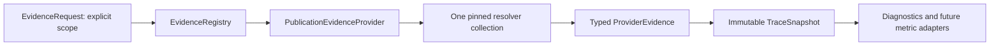

# EvidenceProvider and declaration TraceSnapshot

RFC 0226 slice C1 implements the declaration provider boundary. Slice C2a adds
explicit retained publication execution artifacts. Atom SVC remains a follow-up.

## Run and composition

```bash
.venv/bin/python tools/publication_trace_snapshot.py \
  --repository-root . --repository-id 0al-spec/SpecGraph \
  --revision <commit> --spec-id SG-SPEC-0071
```



`EvidenceProvider` is a Python Protocol: `collect(request) -> ProviderEvidence`,
with `provider_id` and `version`. `EvidenceRegistry` receives reviewed in-process
implementations and invokes each explicitly selected provider once. The default
built-in is `publication.declarations`; `--provider` selects registered IDs.
Unknown/duplicate IDs, invalid subject selection and mismatched result
identity/version/scope are errors. No dynamic imports or plugin discovery occur.

The CLI pins the supplied revision to a full SHA. `EvidenceRequest` carries an
absolute repository root, immutable `EvidenceScope`, explicit node selection
and artifact selection. This first provider requires exactly SG-SPEC-0071 and
`specgraph.publication-exact-links/v1`, rejecting nonempty `artifact_paths`.
It never selects a latest report, runs measured code, tests, network observations
or inference. Constructors and imports do not collect sources.

`collect_publication_links` returns a `PublicationLinkCollection` with immutable
atom declarations/resolutions and the original JSON projection. The provider
consumes this single collection without rereading YAML or inferring atoms from
links. `build_publication_links` preserves the existing business fields and CLI
contract; analyzer fingerprints/content digests change with analyzer code.

## Facts and completeness

`evidence.py` defines typed immutable facts; `publication_provider.py` adapts
inputs. Pure `snapshot.py` performs no Git, filesystem, configuration or artifact
I/O. `ProviderEvidence` retains provider ID/version/profile, analyzer-file hashes,
scope, source digests or unavailable diagnostics and the collection digest.
Each `NodeEvidence` retains all atom declarations, authored links, resolution
candidates, mapping findings and original YAML lifecycle state.

Atom addresses contain spec/local atom ID, file path, JSON pointer and file
digest under the measured revision. File provenance is not presented as a
canonical per-Requirement revision, lineage decision or approval.

Each node has independent flags:

- `inventory.complete`: complete, unambiguous atom enumeration from the resolver.
- `declaration_resolution.complete`: supported resolution with available sources.

`RESOLUTION_COMPLETENESS_SPEC` accepts completed `resolved`, `unresolved`,
`ambiguous` and `wrong_kind` observations. Unsupported, unavailable and unknown
statuses are incomplete. Completeness is not success: a conclusively missing
function is a completed failed resolution. A missing test file leaves a valid
atom inventory complete while making resolution incomplete.

Missing/malformed required spec/passport/binding returns an explicit node with
both flags false and `publication_source_unavailable`, never an apparently
complete empty inventory. Retained partial resolutions and unavailable sources
remain visible. Incomplete evidence is an informational JSON report (exit 0).
Invalid configuration or nonexistent revision exits 1 with no JSON. The older
diagnostic CLI's error behavior remains unchanged.

## Determinism and conflicts

`TraceSnapshot` uses `specgraph.trace-snapshot/declarations-v1`. Its constructor
enforces exact scope/revision and coverage of every selected node, including
unavailable-node records. Nested collections are immutable; serialization
returns fresh JSON containers. These invariants also apply to direct API callers.

Reports and facts are canonically ordered. `content_sha256` uses sorted compact
JSON, excludes checkout location and collection time, and is independent of
provider registration/selection order. Digests record provenance, not
authentication of provider claims.

`observed_subjects` coalesces `(spec_id, atom_id)` across providers while retaining
every report. `observed_subject_count` is not an exact SVC denominator for
incomplete inventories and is never a coverage ratio. `FACT_AGREEMENT_SPEC`
reports differing atom-source or declared-link observations as conflicts with
all variants and origins, without choosing a winner. Other diagnostics,
completeness and lifecycle remain in their original reports rather than becoming
a global approval/health verdict.

## Limits and observation

This profile retains `execution: not_collected`, `fulfillment: not_evaluated`,
`readiness: not_evaluated`, `admission: not_evaluated` and
`canonical_mutations_allowed: false`. It does not implement execution-event
schemas, atom SVC, legacy metric migration, S/U changes, graph maturity,
`tests_verified_v1` or trusted receipt admission.

The [pinned observation](evidence/0226_publication_provider_snapshot.json) records
the actual inventory/snapshot and comparison with the earlier diagnostic.
Synthetic multi-provider tests cover order independence, duplicate identity
coalescing, explicit conflicts and stale scope; they do not claim real additional
providers or executed product tests.

## Retained execution artifacts (C2a)

`PublicationExecutionEvidenceProvider` (`publication.execution`) reads existing
producer JSON, without running pytest, the HTTP verifier, source imports or
inference. Add it explicitly alongside the declaration provider:

```bash
.venv/bin/python tools/publication_trace_snapshot.py \
  --repository-root . --repository-id 0al-spec/SpecGraph \
  --revision <artifact-source-commit> --spec-id SG-SPEC-0071 \
  --provider publication.declarations --provider publication.execution \
  --tests-report /absolute/selected/tests.json \
  --delivery-report /absolute/selected/report.json \
  --run-id <github-run-id> --run-attempt <attempt>
```

At least one report is required; paths and run selection never come from a
latest directory or environment. CLI relative paths resolve against the caller's
working directory. API callers provide absolute paths in immutable
`PublicationExecutionSelection`, independently of the legacy `artifact_paths`
field (which remains rejected). The default declaration-only CLI is unchanged.

Supported producer contracts are `specgraph_publication_test_observation`,
schema 1, and `feature_delivery_signals`, schema 1, profile
`linked_delivery_signals_v1`. The adapter reads up to 2 MiB per selected file,
rejects duplicate JSON keys/nonfinite values and preserves valid parsed producer
reports without rewriting outcomes. Original byte hashes are recorded under
stable `artifact:tests` / `artifact:delivery` source labels; moving identical
selected files does not change snapshot identity. Unavailable/malformed inputs
produce diagnostics and no invented success. Unknown profiles remain unavailable.

The expected file inventory is reconstructed from Git objects at the requested
SHA using the existing producer's inventory: bindings, passport, spec,
implementation, test files, JSON I/O, producer and publication policy package.
`SOURCE_SNAPSHOT_SPEC` compares repository, revision and the exact file hashes;
the current working copy is not the reference. `EXECUTION_BINDING_SPEC` requires
the selected complete GitHub Actions identity (provider, run, attempt and
repository-specific run URI). Current local producers use ambiguous `local-run`
with empty IDs, so they cannot provide this binding profile. Invalid selection
is a CLI error; a stale/missing observation is an informational snapshot.

For tests, `TEST_OBSERVATION_SPEC` checks the exact ordered criterion/test
selectors; `TEST_SUITE_SPEC` interprets the retained case outcomes and exit code.
The original `producer_result` remains separate from `evaluated_result`. A bound
failed suite remains failed; mismatched inputs never receive an evaluated result.
The delivery report retains its normalized tests/deploy/runtime outcomes. Its
test selectors and observer identities are checked. For claimed deploy/runtime
signals, `RETAINED_RUNTIME_BINDING_SPEC` checks the embedded HTTP observation's
revision, full run identity, origin and bundle identity against the selected
report and pinned origin. An externally bound report can still contain an
internally mismatched signal; both statuses remain visible. A producer's missing
signal with no observer is `not_asserted`.

This adapter checks provenance binding, not authenticity or HTTP bytes. It does
not rerun native verification, reread JUnit/XML or bundle payloads, establish
wall-clock freshness, select the newest attempt or authenticate GitHub claims.
Timestamps and all producer metadata stay inside retained reports. Freshness is
explicitly limited to the caller-selected revision and run; digests do not turn
`provider_reported_not_attested` data into trusted receipts. Contradictory retained
outcomes stay separate by artifact/stage; C1 atom/link conflict rules do not pick
an execution winner.

Selecting this provider uses `specgraph.trace-snapshot/execution-v1` and
`execution: retained_artifacts`, including explicit unavailable-artifact entries.
This means collection was attempted, not that execution succeeded. Execution
providers supply no atom inventory: their node completeness flags stay false.
Composition preserves the declaration inventory and does not multiply subjects.
The declaration-only profile and JSON shape remain intact. Fulfillment,
readiness and admission remain `not_evaluated`; canonical mutations stay disabled.

The [real CI observation](evidence/0226_publication_execution_snapshot.json) uses
explicitly downloaded build reports from run `39757869156`, attempt 1, at its
actual PR merge-checkout SHA. Five pytest obligations report success; deploy and
runtime remain missing because this PR run skipped deployment. Synthetic offline
fixtures cover successful HTTP observations and negative binding cases; they do
not establish a live deployment.

Next: qualify atom-to-check channels for a separately reviewed SVC profile and
connect snapshot diagnostics to the existing viewer. Neither is activated here.
