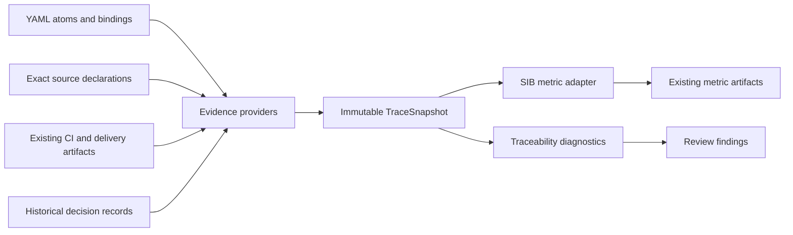

# 0226 Traceability Evidence Providers and SVC

RFC: SG-RFC-0226
Version: 0.1.0

## Status

Draft proposal; architecture and staged realization plan for review.
Compatibility slice B now extracts the existing proxy behind immutable prepared
inputs and a replaceable metric interface. Slice C1 now exposes a declaration-only
EvidenceProvider and immutable TraceSnapshot for the publication pilot. Slice C2a
reads explicitly selected retained execution reports. Atom-level SVC and profile
activation remain `deferred_until_canonicalized`. The bounded
Supervisor cycle and its evidence are recorded in the source draft. This work
does not activate a metric profile, replace the existing proxy, or approve a
canonical semantic change.

```yaml
canonical_mutations_allowed: false
runtime_profile_activation_allowed: false
evidence_admission_allowed: false
```

## Source Material

- [Operator intent, source inspection and Supervisor cycle](../archive/proposal_sources/0226_traceability_evidence_providers_and_svc.md)
- [0043 Metric Pack Plugin Architecture](0043_metric_pack_plugin_architecture.md)
- [SG-SPEC-0021: Derived Metric Family Boundary](../../specs/nodes/SG-SPEC-0021.yaml), primary semantic target
- [SG-SPEC-0020: Executable Layer Traceability Boundary](../../specs/nodes/SG-SPEC-0020.yaml), executable anchors and outcomes
- [SG-SPEC-0071: Publication delivery pilot](../../specs/nodes/SG-SPEC-0071.yaml), first bounded cohort
- [Intent decision review](../intent_decision_review.md), historical change dispositions
- [Publication delivery pilot](../publication_delivery_pilot.md), current test and HTTP observations
- [0221 Stable Requirement Identity](0221_stable_requirement_identity_and_lineage.md)
- [0225 Tests-Verified Evidence Admission Plan](0225_tests_verified_evidence_admission_plan.md)
- [Supervisor cycle observation](../reviews/0226_supervisor_cycle.json) and [review-only semantic candidate](../reviews/0226_metric_verifiability_candidate.patch)

## Problem

SpecGraph already has a declarative metric-pack registry and adapter index, but
its verifiability input is still a bootstrap proxy. In the inspected main
snapshot, `build_spec_trace_index` derives legacy `acceptance_coverage` and
`build_metric_signal_index` averages scores assigned to those statuses. The
input catalog labels that result `spec_verifiability_coverage`. Pack runs copy
existing metric signals; registration alone does not execute a new provider.

The publication pilot now has explicit atom IDs, real test selectors, named
Specifications and revision-bound observations. Intent decision review records
bind changed obligations to exact source declarations. These sources have
useful but different meanings and are not joined into an atom-level SVC input.
Adding all collection, mapping and scoring to `tools/supervisor.py` would
increase coupling in an already large orchestration function.

## Goal and Scope

Introduce replaceable evidence sources, a shared immutable trace snapshot and
independent metric interpretations. Use the publication pilot to characterize
the boundary before broad adoption. Preserve existing CLI/Make entry points,
legacy proxy values and viewer contracts during extraction.

Scope is SpecGraph's evidence-to-metric integration. Metrics owns research
formula definitions. SpecificationMetrics owns its separate source-code
analyzers. Neither repository requires a change for the first SpecGraph slice.
The snapshot is a derived read model; it does not add canonical graph kinds or
claim that source declarations prove behavior.

## Proposed Architecture



### 1. EvidenceProvider

A provider reads one explicitly selected source and returns typed facts plus
source provenance and completeness. Collection receives an explicit repository,
revision, bounded subject selection, artifact selection and profile. It does not
implicitly read process-wide roots, select an arbitrary latest report or run
tests to create its own evidence.

The first implementation uses an explicit in-process registry of reviewed
provider implementations behind one Python `Protocol`. Selection is declarative;
provider IDs and configuration versions are included in provenance. Unknown or
duplicate IDs are configuration errors. Provider order cannot change results.
Dynamic import strings, directory auto-loading, network services and subprocess
plugin discovery are deferred until a concrete second integration requires them.

Initial sources reuse existing parsers and artifacts: canonical atoms and
`verifiable_by`, exact Python declaration resolution, publication bindings,
existing test/delivery reports, and intent review records. They are capability
roles, not a requirement to introduce five implementations in the first PR.

### 2. TraceSnapshot

The snapshot carries an explicit subject set and these separate fact classes:

- **Declared link:** an authored obligation names a verification channel or
  implementation anchor.
- **Resolved link:** the selected declaration or check is resolvable at the exact
  measured source revision under the named resolver profile.
- **Execution observation:** a selected producer reports execution for explicit
  target bindings, source and invocation identity.
- **Result:** success, failure, skipped, missing or another producer-defined
  outcome with its original meaning retained.

Every fact has source references/digests, provider identity/version and its
subject/revision binding. Existing obligation addresses are reused, including
node ID plus explicit atom ID where currently available; a whole-file reference
must not impersonate an exact criterion revision. Stable Requirement identity
from 0221 can be consumed where present without imposing a new ID migration.

Facts are immutable, including nested collections. Multiple provider reports for
the same authored link preserve their origins without counting the atom twice.
Conflicting reports remain explicit; an arbitrary provider order cannot select a
winner. Snapshot identity is deterministic for the same selected inputs;
collection timestamps remain metadata outside that content identity.

Completeness is scoped to a capability and subject set. Missing optional
execution data does not invalidate a complete declaration-resolution inventory.
Incomplete atom enumeration makes an exact SVC denominator unavailable. A stale
or invalid required source never becomes a successful observation or an empty
complete inventory. Partial findings and missing-input diagnostics remain
available when an exact value is unavailable.

A decision review record is historical coverage of a base/head change. Providers
must retain those pins and the PR-body context. It is not perpetual confirmation
of later source code. Reusing its declarations requires resolving them at the
measured snapshot, and never upgrades `covered` to semantic approval.

### 3. Metric Adapter and Checks

Metric adapters are pure interpretations of a prepared snapshot and a versioned
metric profile. They perform no collection, execution or publication. Trace
checks consume the same facts independently and report missing, ambiguous or
stale links. Any decision about blocking CI remains in an explicit reviewed
policy, separate from the measurement.

For the first candidate SVC profile:

- The denominator is the complete selected Intent Atom inventory.
- The numerator counts each atom at most once when at least one operational
  verification channel has a valid, resolved binding under the profile.
- For Python bindings, merely providing a nonempty string does not qualify.
- A completed failing check can establish verifiability while reporting failed
  fulfillment. SVC must not silently become the pass rate.
- Missing or stale execution remains visible independently of a structurally
  valid verification channel.
- Empty subject selection yields `not_applicable` with no ratio in this profile;
  incomplete denominator yields `not_computable`, not zero. This convention must
  be explicit in the profile rather than changing the research formula silently.

The qualification rule is a proposal for review; it is not activated here and
does not establish that a test is semantically sufficient. Distinct declaration,
resolution and execution counts accompany the ratio. `tests_verified_v1`, trusted
receipt admission, runtime verification and product outcome remain separate.

Stable eligibility and interpretation policies should use named SpecificationCore
specifications with immutable contexts, each in its own module. Parsing, Git and
artifact I/O remain procedural adapters. Do not introduce specifications only to
increase the S counter.

### 4. Composition and Compatibility

The composition root selects providers and metric adapters explicitly. It
collects once for the selected snapshot, then passes facts to calculations and
checks. A provider may supply several metrics; a metric may require several
provider capabilities. Required and optional capabilities are declared rather
than inferred from file presence.

Proposed package boundaries live under `tools/traceability/` and
`tools/metric_packs/`; exact filenames are an implementation decision. Existing
`tools/supervisor.py` commands remain façades. Existing registry/index surfaces
continue to describe source and computation readiness. An available adapter
contract alone does not imply successfully collected inputs or a computed value.

The new atom-level result uses its own profile ID/version and input digests. The
legacy `specification_verifiability` proxy and its thresholds remain unchanged
until an explicit migration is reviewed. Historical values from different
profiles cannot be presented as one comparable trend without qualification.

## Bounded Self-Improvement Cycle

1. **Observe:** pin the current implementation and publication bindings; identify
   the proxy-versus-atom input gap.
2. **Propose:** capture the operator request and run one bounded Supervisor pass
   on SG-SPEC-0021; retain the actual outcome and validation, including failures.
3. **Review:** curate this architecture and any semantic candidate with source
   provenance. Supervisor execution does not constitute human approval.
4. **Improve tools:** after the bounded contract is reviewed, extract the existing
   computation behind an unchanged façade, then add the publication provider and
   candidate SVC profile in separate focused PRs.
5. **Observe again:** compare the legacy proxy and the new detailed result for
   SG-SPEC-0071 at one pinned revision; inspect disagreements and negative cases.

The original proposal completed preparation and launched the bounded Supervisor
cycle. The operator subsequently requested implementation, authorizing the
compatibility extraction in slice B. Declaration provider runtime is implemented
in C1; C2a adds retained execution-artifact inputs. Atom-level SVC remains future work. The
SG-SPEC-0021 semantic patch is still a
separate review candidate.

## Realization Slices

| Slice | Deliverable | Verification |
| --- | --- | --- |
| A | Reviewed provider/snapshot/profile contracts and semantic input boundary | Source-grounded review and explicit compatibility decisions |
| B | Implemented: extract existing verifiability computation with immutable prepared inputs and the optional `verifiability_metric` hook | Pre-refactor JSON fixtures, shared-policy boundaries, injectable composition and isolated imports |
| C1 | Implemented: publication declaration EvidenceProvider, explicit registry and immutable TraceSnapshot | Pinned inventories, partial/missing sources, duplicate/conflicting reports and independent CLI |
| C2a | Implemented: explicit retained publication tests/delivery artifacts and run binding | Existing producer contracts, exact Git file inventory/run/attempt, negative nested provenance cases and a real CI artifact |
| C2b | Atom-level SVC profile | Exact atom-to-check inventory, explicit producer observations and source-pinned results |
| D | Connect to existing metric-pack artifacts with explicit provenance | Consumer compatibility, profile-separated comparisons and one real pilot |

Each slice has its own focused PR. Failure or incompleteness stays visible;
activation does not follow automatically from merging the proposal.

## Implemented Compatibility Boundary (Slice B)

`tools/metric_packs/` now contains `VerifiabilityContext`, immutable observations
and results, the `VerifiabilityMetric` protocol, and `LegacyVerifiabilityMetric`.
The legacy JSON adapter prepares the input; the metric performs pure arithmetic
and projection. `SCORE_STATUS_SPEC` names the existing three-way threshold
policy and is also used through the existing Supervisor score-status facade.

`build_metric_signal_index(specs, *, verifiability_metric=None)` selects the
legacy implementation by default. Supplying another implementation of that
protocol is an explicit composition hook; it receives the same prepared context.
This specialized input is not the proposed general TraceSnapshot, and no dynamic
plugin loading or new metric profile is enabled.

The extraction preserves unknown-status counting, numeric coercion, empty-input
behavior, rounding before threshold comparison, the complete serialized metric
entry and existing threshold consumers. Eight golden projections were captured
from the exact pre-refactor production block at commit
`2e33ce2d51b01080f25e592c9232185e01004d34` before editing it. They are retained in
`tests/fixtures/metric_packs/legacy_verifiability.json`; focused tests also check
immutable inputs, trace branch skips, shared score policy, injected composition
and isolated file imports.

A live local trace snapshot of 71 spec entries also produced identical serialized
entries before and after: the legacy proxy stayed at 0.993 (70 `covered`, one
`evidence_linked_unmapped`). This is an acceptance-status proxy, not atom-level
SVC or confirmation that 99.3% of requirements passed tests. The pinned
[compatibility observation](../evidence/0226_legacy_verifiability_compatibility.json)
records both results and source digests.

TP-08 now has compatibility characterization. C1 adds declaration-provider
characterization; C2a adds retained execution observations. Atom-level metric portions below remain planned.
Measurement results and local observations are reported
with the implementing PR; no complexity or S/U improvement is presumed.

## Acceptance Cases for Future Realization

The [EvidenceProvider contract](../evidence_provider.md) describes implemented
slice C1 and retained execution slice C2a. C1 consumes one exact-link collection without changing the diagnostic
facade. Typed scope checks, capability-specific completeness, immutable nested
facts, deterministic identity, duplicate subject coalescing and explicit atom/link
conflicts have focused tests. The [pinned snapshot observation](../evidence/0226_publication_provider_snapshot.json)
records the actual declaration inventory. The [execution observation](../evidence/0226_publication_execution_snapshot.json)
binds real retained CI pytest results while leaving skipped deploy/runtime missing.
SVC qualification, generalized execution-event collection and trusted admission
remain future work in the cases below.

| ID | Case | Expected result |
| --- | --- | --- |
| TP-01 | Atom names a nonexistent test | Declared link retained, resolution fails, atom excluded from qualified numerator |
| TP-02 | Bound test completes with failure | Verifiability retained; failed fulfillment reported separately |
| TP-03 | Optional execution report absent | Resolution-based SVC remains computable; execution observation missing |
| TP-04 | Required inventory incomplete or stale | Exact ratio unavailable; diagnostics and partial facts retained |
| TP-05 | Historical review cites an earlier implementation | Historical pins retained; current resolution required; no approval inference |
| TP-06 | Two providers repeat one link or disagree | One atom counted once; provenance and conflict preserved; order-independent result |
| TP-07 | New provider added | Existing profile and consumer behavior unchanged; no edit to SVC formula required |
| TP-08 | Existing proxy extracted | Fixed-input values, statuses and serialized public fields remain unchanged |
| TP-09 | Code changes while intent is unchanged | Current resolution/freshness reflects selected source; no reuse of stale confirmation |
| TP-10 | Empty selected atom set | Explicit not_applicable result, no invented zero coverage |

TP-08 has executable compatibility characterization in slice B. C1 tests the
provider declaration/scope, missing-input, order and conflict boundaries; C2a
tests producer outcomes, selected revision/run/attempt, nested runtime provenance
and explicit missing signals. Metric qualification remains future work.
Local checks and observations are
reported separately in the implementing PR.

## Open Decisions for Review

- Approve the first resolved-channel qualification profile and its empty-set
  convention, including how non-Python confirmation channels participate later.
- Select the minimal existing artifact inventory consumed by the first provider.
- Decide the additive result field/schema version for existing viewers in slice D.
- Review any Supervisor semantic candidate independently of this tooling design.

## Authority and Non-Goals

Metrics remain diagnostic. This proposal changes no merge thresholds, graph
lifecycle, canonical acceptance, runtime claims, S/U counting or receipt trust.
There is no automatic policy adoption, whole-project gate, new canonical graph
kind, generalized middleware runtime or mandatory instrumentation framework.
