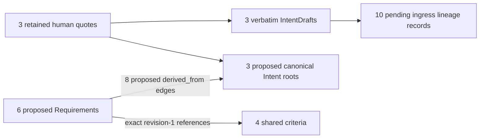

# Authored traceability: canonical adoption preparation

**Status: review pending; no canonical origins, topology or approvals created.**

This is the next bounded preparation after [PR #790](https://github.com/0al-spec/SpecGraph/pull/790),
merged as `bc051b08c68dfe795d10fd9309e98867d3430911`. It uses the actual
[Supervisor candidate](../retry/candidate.yaml), not the older assistant-authored
manual draft. The six Requirement statements, four acceptance statements and
their source references are retained. Engineering choices remain separate;
SG-SPEC-0020 is boundary context, not the derivation of those statements.

## Proposed scope

The [review packet](packet.json), `subject_publication_review_packet` v1,
binds the exact candidate and source bytes. Its `approval_scope_sha256` covers
the packet with only that field omitted, using canonical UTF-8 JSON with sorted
keys, compact separators, Unicode retained, no NaN and no trailing newline.
It is a pending packet, **not** writer input or an approval record.

| Proposed Requirement origin | Source local handle | Exact criterion membership at revision 1 |
| --- | --- | --- |
| `req.atc.source-intent` | ATC-REQ-001 | `ac.atc.source-attribution` |
| `req.atc.obligation-identity` | ATC-REQ-002 | `ac.atc.source-attribution`, `ac.atc.obligation-preservation` |
| `req.atc.authoring-preservation` | ATC-REQ-003 | `ac.atc.obligation-preservation` |
| `req.atc.mapping-coverage` | ATC-REQ-004 | `ac.atc.mapping-scope` |
| `req.atc.harness-scenario` | ATC-REQ-005 | `ac.atc.execution-boundary` |
| `req.atc.evidence-boundary` | ATC-REQ-006 | `ac.atc.execution-boundary` |

These are ten proposed origins: six Requirements and four shared criteria,
not copies of criteria per Requirement. Membership is a proposed interpretation
to review, not an ownership inference from list position. The ATC-REQ handles
remain source-local handles; they are not renamed into already allocated subjects.
All ten pending storage candidates live in [subjects/](subjects/).

The existing SG-SPEC-0069 workspace plan is reused:
`workspace:a2800523-3588-4820-a47f-9fddc0fed3f5`. The
[declaration candidate](../../0221_subject_storage/workspace_identity.yaml)
is still unallocated. No second workspace, new SG-SPEC ID or new proposal ID is
introduced. These local names are review tokens, not reservations. Recheck the
destination namespace and source ref against current state before allocation.

## Intent and graph semantics

[Intent candidates](intent-candidates.json) propose three existing-kind `intent`
roots: `intent.atc.addressability`, `intent.atc.delivery-chain` and
`intent.atc.derivation`. Each retains an exact source-quote reference and keeps
the assistant's normalized statement distinct from that quote. Their proposed
authority class is `distilled`; adoption attribution remains pending.

[Source lineage](intent-lineage.json) retains the three verbatim quotes as
`human_intent_record` exchanges, three matching IntentDrafts and ten pending
proposal-ingress lineage records. `human:SoundBlaster` describes the attribution
of the retained quotes, not verified identity. These are assistant transcriptions,
not independent transcripts or attested sources. Original message times remain
unknown; preparation time is explicitly a different field. The proposed meaning
and source interpretation still need human review.

The eight directed `derived_from` edges use Requirement-to-Intent endpoint
kinds admitted by SG-SPEC-0023 and provide proposed paths for the six
Requirements under SG-SPEC-0061. They are **candidate topology**, not canonical
edges. Proposal citations, pending ingress lineage and a viewer path cannot
substitute for admitted edges. The four criterion references do not themselves
prove SG-SPEC-0061 reachability for criteria; this packet claims no such closure.

## What can use the existing publication mechanism

| Part | Current support | Remaining step |
| --- | --- | --- |
| Six Requirement and four criterion records | SG-SPEC-0069 storage shape, reader, writer and recorded-decision gate exist | Review origin/membership, provenance, activation, allocation and exact publication scope |
| Three Intent roots | Existing semantic kind; logical candidates prepared | Bind their physical source and governed publication route |
| Eight `derived_from` edges | Existing valid endpoint kinds; explicit candidates prepared | Bind canonical relation storage and publication; external relations are not loaded by the current subject source adapter |

`tools/subject_source_write.py` does not publish Intent roots or external graph
relations. Therefore its successful publication of the supported records alone
would **not** complete Intent -> Requirement reachability. No existing writer
publishes this complete chain atomically. This packet does not invent a storage
schema or bypass that missing seam. Its twenty pending SG-SPEC-0051 transition
templates cover only the ten supported subject candidates; they do not purport
to cover Intent or edge publication.

## Existing review boundary

Review this exact scope: the three source interpretations, six statements,
four criteria, shared membership, proposed identities and eight edges.
Do not infer approval from merging PR #790 or this preparation. All lineage
reviews, transition outcomes, origin/activation provenance, workspace allocation,
topology selection, writer request and publication authorization remain pending.
This uses the existing SG-SPEC-0051/0069 decision boundary, without a new gate.

After approval, preserve the packet and pending templates unchanged. Store
actual decisions separately, binding the reviewed commit, packet raw SHA-256
and scope digest. Resolving adoption fields changes a candidate: prepare and
review the new snapshot before publication, as required by the existing
[publication contract](../../../subject_publication.md). Do not approve one
record and fill its pending provenance later under the old digest.

## Validation and limits

[Validation evidence](validation.json) records checks of exact source statements,
membership, source pointers and hashes, paired transitions, endpoint kinds and
proposed Requirement-to-root paths. It is a structural snapshot, not an approval
or proof that a publisher supports the complete chain. The historical
0221-specific packet checker is not represented as validating this new scope.

The six BDD scenarios and sixteen profile cases remain declarations. There are
no new executed BDD tests, runtime observations, evidence transfers or activated
profile checks. Canonical Intent Atoms are unchanged by preparation outside
canonical source paths.

Next implementation slice: an explicit persisted source/publication binding for
the Intent and `derived_from` parts, reusing the existing semantic contracts.
Canonical publication follows only after that path and the exact decisions exist.
