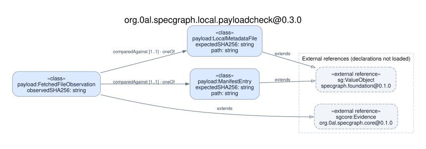

# Payload and manifest digest criteria

This pilot exercises two of the five criteria of `SG-REQ-PUBLICATION-VERIFIED`.
Both ask the bundle verifier to compare fetched bytes with an expected SHA-256.
The expected digest has a different origin in each case.

| Criterion | Address in [SG-SPEC-0071](../../nodes/SG-SPEC-0071.yaml) | Source of the expected digest |
| --- | --- | --- |
| [PB-PAYLOAD](case.json) | `/specification/requirement/criteria/1`, `/atoms/intents/1` | The selected payload's entry in the local manifest. |
| [PB-MANIFEST](manifest-case.json) | `/specification/requirement/criteria/2`, `/atoms/intents/2` | SHA-256 computed from the exact bytes of the retained local `artifact_manifest.json`. Its entries describe payloads; none serves as the expected digest of the manifest itself. |

Each fixture pins the source spec's bytes, criterion ID, statement and existing
pytest binding. The tests also check the binding in the publication passport.

## What the second criterion reused

Both cases use the same three core relations to link the requirement, criterion,
test and evidence. A single [typed graph builder](model.ts) uses the SDKs generated
from the project core and the [local package](domain-ontology-package.yaml).
The fetched digest is represented by the same observation type in both cases.
`comparedAgainst` selects exactly one expected source per observation.

The first pilot used `ManifestEntry` and `PayloadObservation`. The second adds
one source type, `LocalManifest`. Both source types have a path and an expected
digest. Draft package version 0.2.0 names their shared observation
`FetchedFileObservation` and widens the range of the existing relation to
`oneOf(ManifestEntry, LocalManifest)`. The arrows in the diagram are alternatives.



The compiled SDK and [type diagram](ontology.dot) allow both targets. The
criterion-specific endpoint check supplies the narrower rule. In a disposable
copy, assigning the `ManifestEntry` type to PB-MANIFEST's reference still
type-checked, but its endpoint test expected `LocalManifest` and failed.
The compiler itself rejects an unknown type in the relation's range. The
earlier [core-only experiment](https://github.com/0al-spec/SpecGraph/tree/045b43f662c8cb28a5507361be38b89a61128229/specs/models/SG-SPEC-0071)
also showed that the generated core `Evidence` type lacks `observedSHA256`
(TypeScript `TS2353`).

## Behavior observed

The tests call the production [bundle verifier](../../../tools/static_artifact_incremental_stage.py)
with an in-memory HTTPS fetcher. The fixture replaces only the selected remote
response. All manifest runs retain the same local manifest, payload `abc` and
checksums. The stale manifest is valid JSON of the same length and contains the
digest of the earlier payload `abd`.

| Criterion | Remote response | Production result |
| --- | --- | --- |
| PB-PAYLOAD | `abc` | `verified` |
| PB-PAYLOAD | `abd` | `remote artifact digest mismatch: payload.txt` |
| PB-MANIFEST | Exact local manifest bytes | `verified`; the report identifies the local manifest digest |
| PB-MANIFEST | Stale manifest | `remote metadata digest mismatch: artifact_manifest.json` |
| PB-MANIFEST | Current manifest followed by one ASCII space | Same metadata mismatch, even though the parsed JSON is equal |

The whitespace case characterizes the current implementation's byte-level
comparison. The canonical obligation names a stale manifest. These synthetic
observations do not establish what is currently deployed.

## Replay

Use the extracted Ontology 0.5.0 tools, TypeScript 6.0.3 and Node on PATH.
From the repository root:

```sh
ONTOLOGYC_BINARY_PATH=/absolute/path/to/ontologyc \
TYPESCRIPT_TSC_PATH=/absolute/path/to/typescript/bin/tsc \
  .venv/bin/python -m pytest -v tests/test_publication_digest_ontology_model.py \
  tests/test_static_artifact_incremental_stage.py::test_pb_payload_model_against_bundle_verifier \
  tests/test_static_artifact_incremental_stage.py::test_pb_manifest_model_against_bundle_verifier

/absolute/path/to/ontologyviz specs/models/SG-SPEC-0071/domain-ontology-package.yaml \
  --format svg --out /path/to/diagram
```

The macOS compatibility job compiles both SDKs once, checks both models and
compares the released visualizer's DOT to the checked-in diagram. Source
bindings and byte-level behavior tests also run with Python alone.
